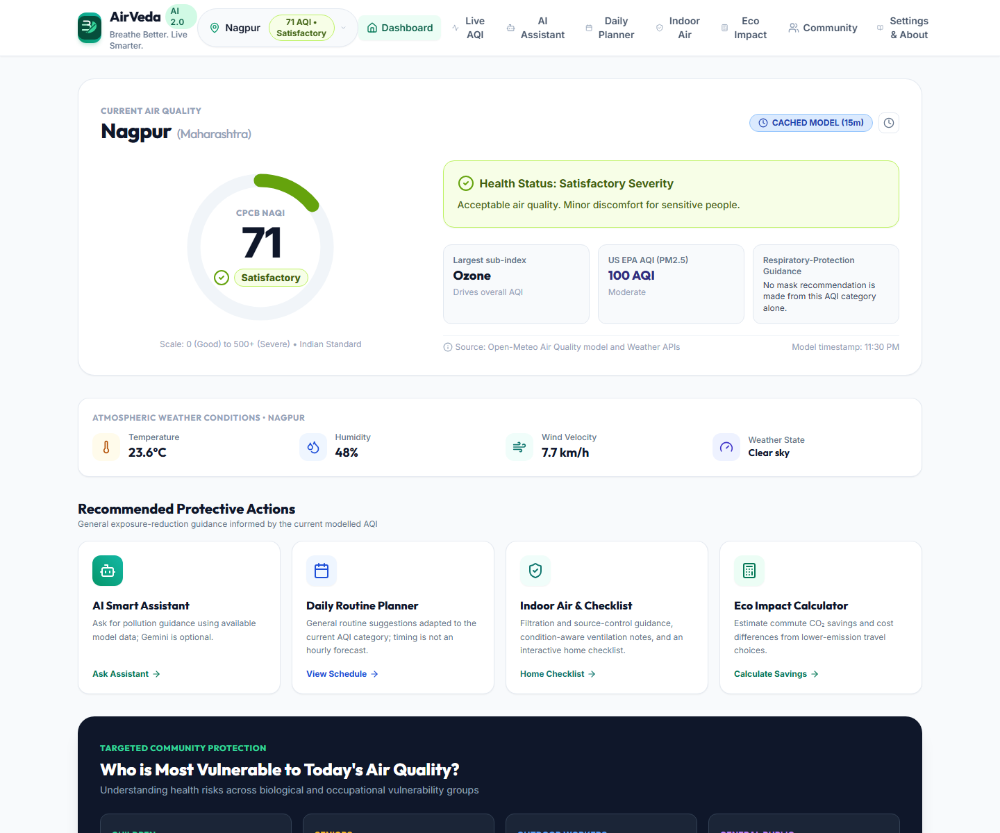

# AirVeda

**Breathe Better. Live Smarter.**

AirVeda is an AI-powered urban air-quality assistant for families and communities. It combines Open-Meteo air-quality and weather model data with CPCB NAQI calculations, clear health-protection guidance, a routine planner, indoor-air checklist, and an emissions calculator.

> **Data and health notice:** AirVeda displays modelled atmospheric estimates, not ground-station measurements. It does not invent replacement readings when a source is unavailable. CPCB NAQI and US EPA AQI are separate scales. AirVeda is not a medical device and does not provide diagnoses or treatment.

## Problem

Winter smog and urban pollution make it difficult for people to plan commutes, exercise, ventilation, and family activities. AirVeda brings current modelled conditions and practical, understandable recommendations together while making data limitations visible.

## Features

- Current pollutant concentrations, CPCB NAQI, separate US EPA PM2.5 AQI, and Open-Meteo weather.
- Nagpur, India as the default location, city search, and optional browser geolocation.
- Hourly air-quality trends when the provider returns data; no generated trend curves.
- Gemini-backed pollution Q&A through the FastAPI server, with a transparent general-guidance fallback.
- Routine plans for families, students, professionals, seniors, outdoor workers, and fitness enthusiasts.
- Indoor-air recommendations and an interactive home checklist.
- Transport CO₂ calculator with illustrative emission-factor and cost assumptions; actual results vary, and CO₂ savings are not presented as local PM2.5 reductions.
- Community trends sourced from the same model data and self-guided challenges without fabricated participation or neighborhood statistics.
- Accessible semantic controls, keyboard focus indicators, chart data tables, and reduced-motion support.

## Screenshots

Captured from the running application with current Open-Meteo model data (not a mockup):



## Technology

- Frontend: React 18, TypeScript, Vite, Tailwind CSS, Lucide React, Recharts
- Backend: Python 3.11+, FastAPI, Pydantic, HTTPX
- AI: Google Gemini API (optional, configured only on the backend)
- External data: Open-Meteo Air Quality, Weather, and Geocoding APIs
- Tests: Vitest, React Testing Library, Pytest

## Architecture

```text
Browser (React + TypeScript)
  └── /api requests → Vite development proxy → FastAPI
                                        ├── Open-Meteo APIs
                                        └── Gemini API (server-side key)
```

The browser never receives the Gemini API key. The backend validates API inputs, restricts CORS, applies rate limits to AI chat, and returns a safe service-unavailable response when live data cannot be retrieved. Air-quality results are cached briefly and labelled when served from cache.

## Requirements

- Node.js 18+ and npm
- Python 3.11+
- Internet access for Open-Meteo data; a Gemini API key is optional

## Installation and run

### Backend (PowerShell)

```powershell
cd backend
py -3.11 -m venv .venv
.\.venv\Scripts\Activate.ps1
python -m pip install -r requirements.txt
Copy-Item .env.example .env
# Optionally edit .env and set GEMINI_API_KEY.
python -m uvicorn app.main:app --reload --host 127.0.0.1 --port 8000
```

To run from Command Prompt instead of PowerShell, activate with `.\.venv\Scripts\activate.bat`.

### Frontend (a second terminal)

```powershell
cd frontend
npm ci
npm run dev
```

Open <http://localhost:5173>. Vite proxies `/api` requests to `http://localhost:8000`.

### Environment variables

Copy `backend/.env.example` to `backend/.env`. Configure `GEMINI_API_KEY` only in this backend file or in the deployment environment. Never put the key in a `VITE_*` variable or frontend source.

| Variable | Purpose | Default |
|---|---|---|
| `GEMINI_API_KEY` | Optional server-side Gemini access | Empty (expert rule-based guidance) |
| `GEMINI_MODEL` | Gemini model name | `gemini-2.0-flash` |
| `ENVIRONMENT` | Runtime environment label | `development` |
| `ALLOWED_ORIGINS` | Comma-separated CORS origins | Local Vite origins |
| `CACHE_TTL_SECONDS` | AQI/weather cache duration | `900` |
| `AI_RATE_LIMIT` | AI endpoint limit | `30/minute` |
| `API_RATE_LIMIT` | General API limit | `120/minute` |

## API

FastAPI's interactive API documentation is available at <http://localhost:8000/docs>.

| Method | Endpoint | Purpose |
|---|---|---|
| `GET` | `/api/health` | Service status |
| `GET` | `/api/aqi/current?city=Nagpur` | Current modelled air quality and weather |
| `GET` | `/api/aqi/historical?city=Nagpur` | Available hourly modelled trend |
| `GET` | `/api/aqi/cities?q=Nag` | City geocoding search |
| `GET` | `/api/aqi/methodology` | AQI formula and source notes |
| `POST` | `/api/ai/chat` | Contextual pollution guidance |
| `GET` | `/api/ai/suggested-questions` | Suggested chat prompts |
| `POST` | `/api/planner/generate` | Routine recommendations |
| `POST` | `/api/calculator/eco-impact` | Transport emissions estimate |
| `GET` | `/api/indoor/checklist` | Indoor-air checklist |
| `GET` | `/api/indoor/ventilation-advice` | AQI-based ventilation guidance |
| `GET` | `/api/community/challenges` | Self-guided community actions |

Unavailable or incomplete provider data returns an error instead of a synthetic reading. AQI values are calculated from the concentrations returned by Open-Meteo. The hourly trend's CPCB-style index only uses PM2.5 and PM10 because the hourly request does not include gas sub-indices.

## Tests and production build

```powershell
# Frontend
cd frontend
npm ci
npm test
npm run build

# Backend (separate terminal)
cd backend
py -3.11 -m venv .venv
.\.venv\Scripts\Activate.ps1
python -m pip install -r requirements.txt
python -m pytest
```

## Contributions

See [CONTRIBUTING.md](CONTRIBUTING.md). Please include tests for behavioral changes and preserve the no-fabricated-readings rule.

## Security

See [SECURITY.md](SECURITY.md). Do not commit `.env` files, API keys, or other credentials.

## Roadmap

- Add verified ground-monitor sources with provider, station, and observation-time metadata.
- Support more air-quality authorities and source-specific AQI standards.
- Add documented end-to-end browser tests and deployment configuration.
- Add opt-in, privacy-preserving community data only when a reliable source and consent model exist.

## License

No license has been selected yet. A license file will be added only after the project owner confirms the choice.